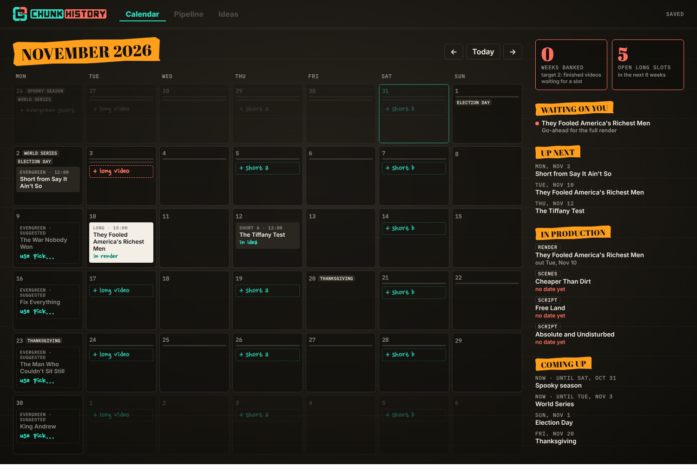

# Chunk History · Video Planner

A local web app for planning and scheduling Chunk History releases: one long video and three Shorts a week, the pipeline
behind them, and (coming) Claude for ideas and optional scheduled uploads to YouTube. The full plan is in [`PLAN.md`](PLAN.md).



## Run it

```bash
npm install
npm run dev
```

Then open http://localhost:5173. It only listens on this computer.

Everything you plan is saved to [`data/planner.json`](data/planner.json) as you go. Commit that file to keep a history (and so
a Claude session working on a video can update its status there).

## What's here (step 1)

- **Release calendar** with the weekly cadence: Monday evergreen Short, Tuesday long video, Thursday Short A, Saturday Short B
  (days and times are in `settings.cadence` in the data file).
- Click an empty slot to book a video or Short, or plan a new one by working title. Shorts in Thursday/Saturday slots attach to
  that week's long video.
- **Evergreen suggestions:** each open Monday suggests an older video to resurface: one that fits a season (spooky season, World
  Series, Black History Month…) first, otherwise the one promoted longest ago. Click *use* to accept it.
- Release windows shown on the calendar; open long slots in the next two weeks are marked in coral.
- Sidebar: weeks banked, open long slots, what's waiting on you, what's next, what's in production.

## Starting data

`data/planner.json` was built from the style repo's catalog (`15minhistorystyle/videos/README.md`) by
`node scripts/seed.mjs ../15minhistorystyle`. Publish dates weren't in the catalog, so past releases are empty; add them if you
want the history on the calendar. Re-running the seed won't overwrite your data unless you pass `--force`.

## Build order

See `PLAN.md` §9. Next: the pipeline board, then the video page, then Claude and YouTube.
