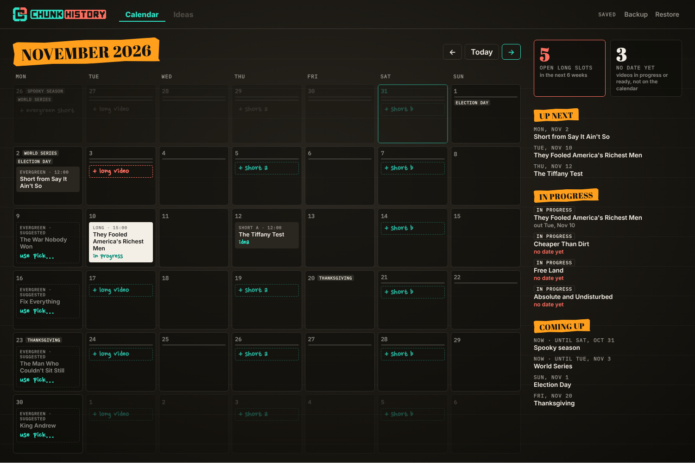

# Chunk History · Video Planner

A private planner for the channel's releases: one long video and three Shorts a week, an ideas list, and notes per video.
It runs free on Cloudflare (a Worker with a D1 database), and only you can sign in. The plan is in [`PLAN.md`](PLAN.md).



## What it does now

- **Calendar** with the weekly slots: Monday evergreen Short (from an older video), Tuesday long video, Thursday Short A,
  Saturday Short B. Click an empty slot to book a video or Short, or plan a new one by working title.
- **Monday suggestions:** each open Monday suggests an older video to make a Short from: one that fits the season first
  (spooky season, World Series, Black History Month…), otherwise the one promoted longest ago. Click *use* to accept.
- Each video has one status: **Idea → In progress → Ready → Published**.
- Sidebar: open long slots in the next 6 weeks, videos with no date yet, what's next, and upcoming seasons.
- **Backup** downloads everything as a file; **Restore** loads one back.
- Open it on your PC and your phone. Coming back to a tab picks up changes made on the other device, and a stale tab can't
  overwrite newer changes.

## Put it online (one-time, about 15 minutes, free)

Nothing below costs money. You'll end up with a private address like `https://chunk-planner.<you>.workers.dev`.

**1. Make a Cloudflare account** at https://dash.cloudflare.com/sign-up.

**2. Create the database** (done): **Storage & databases → D1 SQL database → Create database**, named `chunk-planner`. Its
ID is in `wrangler.toml`.

**3. Create the Worker** (done): **Compute → Workers & Pages → Create → Import a repository**, the `VideoPlanner` repo,
branch `ccr-a7225c84-5fg71s`. Build command `npm run build`; deploy command `npx wrangler deploy` (the default). The
Worker's name must be `chunk-planner`, the same as `name` in `wrangler.toml`.

When it deploys, open the Worker's address (on its page, under **Domains & Routes** or **Visit**). You should see *"almost
there: the planner is locked until Cloudflare Access is set up"*. That's on purpose: your plans stay locked until step 4.

**4. Lock it to you.**
- On the Worker's page: **Settings → Domains & Routes**. Next to the `workers.dev` address, open the **⋯** menu (or the
  toggle) and choose **Enable Cloudflare Access**. If Cloudflare asks you to set up Zero Trust first, pick a **team name**
  (anything, e.g. `chunkhistory`) and the **Free** plan. (It may ask for a card; the free plan isn't charged.)
- Open **Zero Trust → Access → Applications** and click the new application for the Worker. Under its policy, make sure only
  **your email** is allowed (Include → Emails). Sign-in method: **One-time PIN** (Cloudflare emails you a code).
- On that application's page, copy the **Application Audience (AUD) Tag**.

Paste the AUD tag and your team domain (`<team name>.cloudflareaccess.com`, shown under **Zero Trust → Settings**) to
Claude, or put them in `wrangler.toml` under `[vars]` yourself and commit. Cloudflare redeploys by itself; a minute later the
address asks you to sign in, and then shows your calendar.

Optional, for a second lock: on the Worker, **Settings → Variables and Secrets → Add**, type **Secret**, name
`ALLOWED_EMAILS`, value your email.

**After that,** every change pushed to that branch deploys by itself. The planner's data lives in the database, not in the
repo, so use **Backup** now and then.

## Run it on your computer (optional, for development)

```bash
npm install
cp .dev.vars.example .dev.vars   # skips sign-in, on localhost only
npm run dev                      # opens on http://localhost:5173 with a local database
```

`data/seed.json` is the starting data, built from the style repo's catalog by `npm run seed -- ../15minhistorystyle`. It's
loaded into the database the first time the planner opens.
